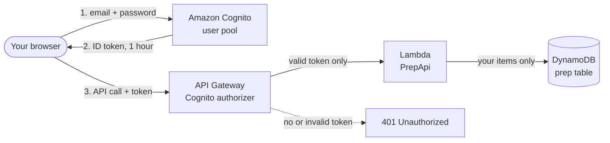

# Developer Guide: Private Interview Prep Portal

The AI Resume Analyzer includes a **developer-only page** for interview preparation: 40 questions about this project (20 for Cloud Engineer roles, 20 for Software Developer roles) with answer guides, practice mode, and space to write your own answers.

- A small **Developer** link at the bottom of the app opens it. The link is hidden for normal visitors.
- The page requires a **sign-in**. Only accounts you create yourself can sign in; public sign-up is disabled.
- Your answers, progress and questions are **stored in AWS (DynamoDB)**, so they follow you to any device and browser.

> This file is safe to publish. It contains no passwords, keys or personal data. Never commit those.

---

## How it works



1. The page lives at `frontend/dev/index.html` and is served by CloudFront at `/dev/index.html`.
2. You sign in with **Amazon Cognito**. Cognito returns an **ID token** valid for 1 hour, kept only for the browser tab's session.
3. Every request to `/prep/*` carries that token. **API Gateway's Cognito authorizer** rejects any request without a valid token before it reaches Lambda.
4. The `PrepApi` Lambda reads and writes the **DynamoDB** table, partitioned by your Cognito user ID, so an account can only ever see its own data.

### Why DynamoDB for your answers?

| Option | Verdict |
|---|---|
| **DynamoDB** ✅ | Each question is a small record that changes often (ticking "practiced", typing notes). DynamoDB updates a single field cheaply and instantly, is already used by this app, costs nothing at this scale, and has point-in-time recovery. |
| S3 JSON file | Every small edit would rewrite the whole file, and two tabs could overwrite each other's changes. |
| RDS / Aurora | Always-on cost and a VPC, which is far too heavy for one person's notes. |

**Table: `ai-resume-analyzer-prep`**

| Attribute | Example | Notes |
|---|---|---|
| `userId` (partition key) | `a1b2c3d4-...` | Your Cognito user ID ("sub") |
| `questionId` (sort key) | `ce-01`, `se-c9x2k1` | Starter questions use `ce-`/`se-`; ones you add get `ce-c…`/`se-c…` |
| `role`, `order`, `category`, `difficulty` | `cloud`, `1`, `Security`, `Medium` | |
| `question`, `points`, `project`, `tip`, `similar` | | The question content |
| `practiced`, `notes` | `true`, `"My answer…"` | **Your progress and answers** |
| `custom`, `updatedAt` | `true`, `1793000000` | |

Protection for your data:
- **Point-in-time recovery**: restore the table to any second in the last 35 days.
- **`DeletionPolicy: Retain`**: the table survives even if you run `sam delete`.
- **Download backup** button on the page: saves everything as a JSON file you can restore later.

### Security model (good to explain in interviews)

| What | Protected by |
|---|---|
| Your questions, answers and progress | Cognito sign-in + API Gateway authorizer + per-user partition key |
| Who can sign in | `AllowAdminCreateUserOnly`: accounts can only be created by you via the AWS CLI |
| The page's code (HTML/JS) | **Public on purpose.** Like the rest of the repo, it contains no data. Anyone who finds `/dev/index.html` only sees a sign-in form. |
| The footer link | Hidden by default. This is a convenience, **not** security. The sign-in is what protects the data. |
| The starter questions file | `dev-data/` is in `.gitignore`, so the question content never goes to GitHub |

Trade-off to know: the page uses Cognito's `USER_PASSWORD_AUTH` flow (password sent to Cognito over HTTPS) because it needs no extra libraries. The stronger SRP flow or Cognito's managed login page would be the upgrade path.

---

## Files

```
backend/app/
├── template.yaml        # adds: DevUserPool, DevUserPoolClient, PrepTable, PrepApiFunction, Cognito authorizer
└── prep_api/
    ├── app.py           # GET/PUT/PATCH/DELETE /prep/questions
    └── requirements.txt
frontend/
├── dev/index.html       # the private page
├── config.js            # adds COGNITO_REGION and COGNITO_CLIENT_ID
├── index.html           # adds the hidden footer link
└── app.js               # shows the link only in browsers you've enabled
scripts/
└── seed_prep.py         # loads the starter questions, or restores a backup
dev-data/                # NOT in git
└── questions.json       # the 40 starter questions
DEVELOPER.md             # this file
```

---

## One-time setup

All commands are for **PowerShell**, run from the project root `C:\Users\Rishekesh.B\ai-resume-analyzer` unless stated.

### Step 1: Create a branch
```powershell
git checkout main
git pull
git checkout -b feature/dev-portal
```

### Step 2: Add the files
- `backend/app/prep_api/app.py` and an empty `backend/app/prep_api/requirements.txt`
- `frontend/dev/index.html`
- `scripts/seed_prep.py`
- `dev-data/questions.json`
- `DEVELOPER.md` (this file) in the project root
- Replace `backend/app/template.yaml` with the new version. **Before saving, put your email back** in the `AlertEmail` → `Default:` line, and re-apply any other changes you made to your own copy.

### Step 3: Keep the questions file out of git
Add this line to `.gitignore`:
```
dev-data/
```
Check it worked: `git status` must **not** list `dev-data`.

### Step 4: Add the footer link to the main app

**`frontend/index.html`**: inside the `<footer>`, after the GitHub link, add:
```html
    <a href="dev/index.html" id="dev-link" hidden> · Developer</a>
```

**`frontend/app.js`**: add at the very bottom:
```js
// ---------- Developer link ----------
// Hidden for visitors. Open the site once with ?dev=1 to show it in this browser
// (?dev=0 hides it again). Signing in to the developer page also enables it.
// This only controls visibility; the developer page itself requires a sign-in.
(function () {
  try {
    const flag = new URLSearchParams(location.search).get("dev");
    if (flag === "1") localStorage.setItem("devLink", "1");
    if (flag === "0") localStorage.removeItem("devLink");
    $("dev-link").hidden = localStorage.getItem("devLink") !== "1";
  } catch { /* storage unavailable: keep the link hidden */ }
})();
```

### Step 5: Deploy the backend
```powershell
cd backend\app
sam validate --lint
sam build
sam deploy
cd ..\..
```
In the changeset you should see **Add** for `DevUserPool`, `DevUserPoolClient`, `PrepTable`, `PrepApiFunction` and its API routes, and **Modify** for `ResumeApi`. The API URL does **not** change.

### Step 6: Create your account
Get the user pool ID:
```powershell
$pool = aws cloudformation describe-stacks --stack-name ai-resume-analyzer --region us-east-1 --query "Stacks[0].Outputs[?OutputKey=='DevUserPoolId'].OutputValue" --output text
$pool
```
Create your user (no invitation email is sent):
```powershell
aws cognito-idp admin-create-user --region us-east-1 --user-pool-id $pool --username YOUR-EMAIL --user-attributes Name=email,Value=YOUR-EMAIL Name=email_verified,Value=true --message-action SUPPRESS
```
Set a permanent password: at least 12 characters with uppercase, lowercase and a number. Use a password manager.
```powershell
aws cognito-idp admin-set-user-password --region us-east-1 --user-pool-id $pool --username YOUR-EMAIL --password "YOUR-STRONG-PASSWORD" --permanent
```
Then clear the password from your terminal history:
```powershell
Clear-History
Remove-Item (Get-PSReadLineOption).HistorySavePath -ErrorAction SilentlyContinue
```

### Step 7: Load the 40 starter questions
```powershell
python scripts\seed_prep.py YOUR-EMAIL
```
Expected: `Written: 40   Skipped (already existed): 0`. Running it again is safe; existing questions are skipped, so your edits and notes are never overwritten.

### Step 8: Point the frontend at Cognito
Get the client ID (it's not a secret, just an identifier):
```powershell
aws cloudformation describe-stacks --stack-name ai-resume-analyzer --region us-east-1 --query "Stacks[0].Outputs[?OutputKey=='DevUserPoolClientId'].OutputValue" --output text
```
Update `frontend/config.js`:
```js
window.APP_CONFIG = {
  API_BASE_URL: "https://YOUR-API-ID.execute-api.us-east-1.amazonaws.com/Prod",
  COGNITO_REGION: "us-east-1",
  COGNITO_CLIENT_ID: "PASTE-CLIENT-ID",
};
```

### Step 9: Deploy the frontend
```powershell
python scripts\deploy_frontend.py
```
The script uploads the new `dev/` folder automatically.

### Step 10: Try it
1. Wait about a minute, then open `https://YOUR-SITE.cloudfront.net/?dev=1` and press **Ctrl + F5**. The **Developer** link appears in the footer.
2. Click it, sign in, and you'll see your 40 questions.
3. Tick a question as practiced and type a note. The status should say **"All changes saved to AWS ✓"**.
4. Open the page on your phone or another browser, sign in, and your note is there.
5. Security check: open `https://YOUR-SITE.cloudfront.net/` in a private window. There's no Developer link. Visiting `/dev/index.html` directly shows only the sign-in form.

### Step 11: Commit
```powershell
git status
git add DEVELOPER.md .gitignore backend/app/template.yaml backend/app/prep_api frontend scripts/seed_prep.py
git commit -m "feat(dev): private interview prep portal with Cognito auth and DynamoDB storage"
git push -u origin feature/dev-portal
```
Check `git status` does **not** list `dev-data/`. Then merge the PR on GitHub and run `git checkout main; git pull`.

---

## Everyday use

| Task | How |
|---|---|
| Open the page | Footer → **Developer**, or go to `/dev/index.html` |
| Write an answer | Open a question and type in **Your answer / notes**. It saves automatically after you stop typing. |
| Track progress | Tick **Practiced**; the progress bar is per tab |
| Practice | **🎯 Practice mode** picks a random question from the current filters |
| Add a question | **＋ Add question** |
| Edit or delete a question | Open it → **✎ Edit question** / **Delete**. Editing keeps your notes and practiced tick. |
| Back up | **⇩ Download backup** saves a JSON file. Keep it out of the repo (for example in `dev-data/`). |
| Sign out | **Sign out** (top right). Closing the tab also ends the session. |

Sessions last 1 hour; after that the page asks you to sign in again. Anything not yet saved shows "Not saved" in the status line, so just retype or tick again after signing in.

---

## Maintenance

**Restore from a backup** (overwrites matching questions, including notes):
```powershell
python scripts\seed_prep.py YOUR-EMAIL --file dev-data\interview-prep-backup-2026-10-26.json --overwrite
```

**Restore the table to an earlier point in time** (for example after deleting something by mistake): AWS console → DynamoDB → `ai-resume-analyzer-prep` → **Backups** → **Restore to point in time**. This creates a new table; copy what you need back, or ask for a script.

**Change your password:**
```powershell
aws cognito-idp admin-set-user-password --region us-east-1 --user-pool-id $pool --username YOUR-EMAIL --password "NEW-PASSWORD" --permanent
```

**Hide or show the footer link** in a browser: open the site with `?dev=0` or `?dev=1`.

**Remove the feature:** delete the four resources and routes from `template.yaml` and redeploy. The prep table is retained; delete it manually in the DynamoDB console if you no longer want it.

---

## Cost

Effectively **$0**. Cognito's free tier covers a single user; DynamoDB on-demand, Lambda and API Gateway charges for a few hundred requests are fractions of a cent; point-in-time recovery costs about $0.20 per GB-month, and your data is a few kilobytes.

---

## Troubleshooting

| Problem | Fix |
|---|---|
| Sign-in form says "Setup needed" | `COGNITO_CLIENT_ID` is missing from `frontend/config.js`. Add it and run `deploy_frontend.py`. |
| "Incorrect email or password" | Check the email matches the Cognito username exactly. Reset the password with the command above. |
| "This account still has a temporary password" | Run the `admin-set-user-password ... --permanent` command from Step 6. |
| "blocked by CORS policy" on `/prep/...` | Check the deploy finished (`UPDATE_COMPLETE`) and that you're on the CloudFront site, not `localhost`. |
| Page loads but the list says "No questions yet" | Run `scripts\seed_prep.py YOUR-EMAIL` with the same email you sign in with. |
| `seed_prep.py` fails with `UserNotFoundException` | Create the user first (Step 6). |
| Developer link doesn't appear | Open the site once with `?dev=1`, then Ctrl + F5. |
| "Too many requests" | API throttling; wait a few seconds. Notes save after you stop typing, so normal use stays well under the limit. |
| `sam deploy` fails with "AlertEmail must be a valid email address" | Put your email back in the `AlertEmail` default in `template.yaml`. |
